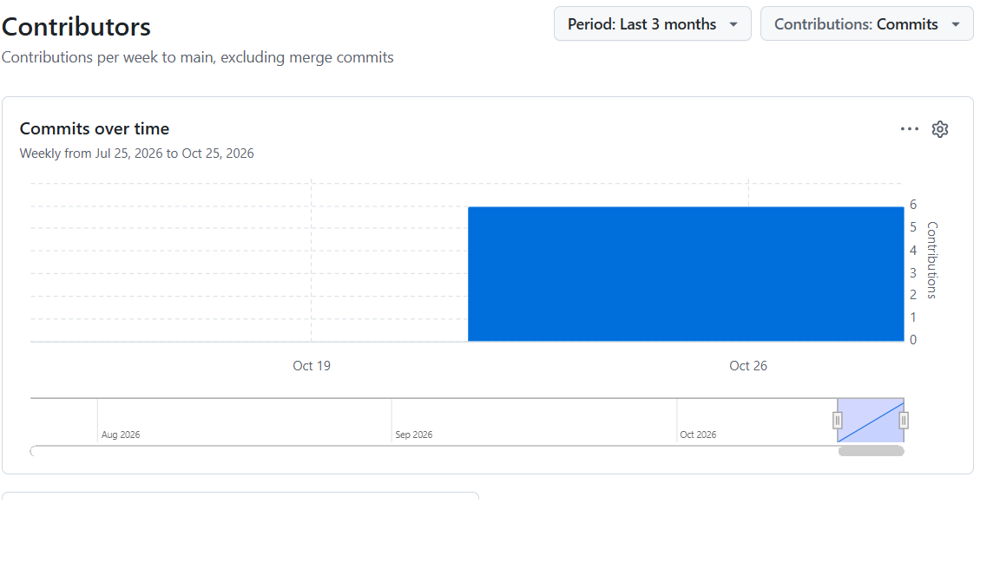

# WUA Cafeteria Express — Final Submission

## Repository Information

- **Repository URL:** (https://github.com/mcgthankie6/wua-food-delivery)
- **Project:** WUA Cafeteria Express
- **Final Version:** v1.0-submission
- **Methodology:** Agile
- **Version Control:** Git and GitHub

## Team Members

| No. | Full Name | Student ID |
|---|---|---|
| 1 | [Tanyaradzwa k mugwagwa] | [W251718] |
| 2 | [Lisa Hove] | [W260232] |
| 3 | [Nicole Zowa] | [W260886] |
| 4 | [Michael Z Maraura] | [W250133] |

## Merged Pull Requests

1. **User Authentication:** https://github.com/mcgthankie6/wua-food-delivery/pull/1
2. **User Authentication:** https://github.com/mcgthankie6/wua-food-delivery/pull/2
3. **Menu Browsing:** https://github.com/mcgthankie6/wua-food-delivery/pull/3
4. **Order Tracking:** https://github.com/mcgthankie6/wua-food-delivery/pull/4
5. **Menu Search:** https://github.com/mcgthankie6/wua-food-delivery/pull/5
## Contribution Graph

## GitHub Release

- **Release:** WUA Cafeteria Express v1.0
- **Release URL:** [https://github.com/mcgthankie6/wua-food-delivery/releases]

## Project Summary

WUA Cafeteria Express is a campus food ordering and delivery application intended to help students, staff, and faculty browse cafeteria menus, place orders, track deliveries, and make cashless payments. Git and GitHub supported collaborative development through branching, commits, pull requests, code reviews, and version control.
